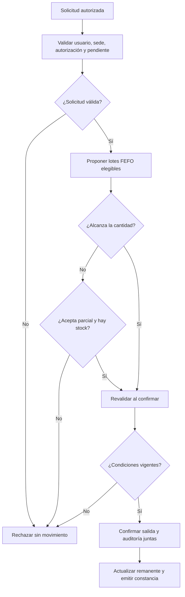
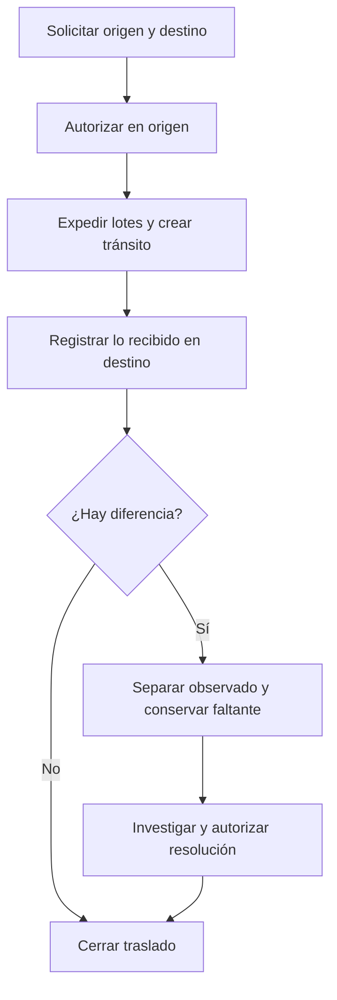

# Procesos de negocio propuestos

**Proyecto:** MedStock · **Versión:** 0.3.0 · **Fecha:** 2026-10-15

**Estado:** borrador de análisis para revisión del propietario. Decisiones del propietario aceptadas; detalles operativos pendientes según 14.

## Naturaleza del modelo

No existe un AS-IS observado. Los procesos siguientes son el TO-BE de MedStock,
construido desde decisiones del propietario y reglas propuestas. RN en 07 es la
fuente normativa. El responsable farmacéutico validará la aplicación operativa.

| Proceso | Disparador / entrada | Secuencia normal | Salida | Excepción principal |
|---|---|---|---|---|
| PR-01 Organización y catálogo | Nueva sede o producto | Validar códigos, definir ámbito/unidad, registrar | Entidad utilizable sin stock ficticio | Duplicado o conversión incompatible |
| PR-02 Recepción | Documento y productos físicos | Capturar lotes, evaluar, separar observado, confirmar | Entrada utilizable/cuarentena y constancia | Fecha/lote contradictorio, reintento o fallo |
| PR-03 Consulta | Necesidad de stock | Filtrar ámbito, consultar por condición, mostrar corte | Disponibilidad explicada | Sin permiso o resultado desactualizado |
| PR-04 Solicitud | Necesidad de servicio | Crear líneas, validar unidad, enviar | Demanda pendiente de autorización; envío sin reserva | Producto inactivo, cantidades inválidas |
| PR-05 Despacho | Solicitud autorizada vigente | Revisar, proponer FEFO, aceptar parcial si aplica, revalidar, confirmar | Salida y remanente/atención completa | Cambio de stock, bloqueo, fallo o respuesta perdida |
| PR-06 Traslado | Reposición entre ubicaciones de custodia | Solicitar, autorizar, expedir, transportar, recibir, resolver diferencias | Origen/tránsito/destino reconciliados | Faltante, daño, repetición, destino inactivo |
| PR-07 Devolución | Retorno de una salida | Verificar origen/cantidad, recibir en cuarentena, evaluar | Liberación o segregación con motivo | Lote no corresponde, vencido o cantidad excesiva |
| PR-08 Conteo y ajuste | Inventario físico | Registrar corte/conteo, proponer diferencia, autorizar otro usuario, aplicar | Compensación trazable | Autoaprobación, concurrencia o saldo negativo |
| PR-09 Bloqueo/retiro/baja | Alerta o evaluación | Identificar lote, bloquear ámbito, localizar, segregar, autorizar salida | Stock no despachable y seguimiento | Lote en tránsito o ya despachado |
| PR-10 Auditoría | Revisión periódica/incidente | Consultar relaciones, conciliar, verificar contra referencia | Informe con alcance y anomalías | Cadena incompleta o referencia no confiable |

## Actividad de despacho

Si existe reserva, el despacho consume su asignación vigente según CU-017, revalidando
lote, tiempo y remanente. Sin reserva usa libre elegible.

Una confirmación con respuesta perdida puede haber tenido éxito: se consulta su
identidad de operación antes de repetir. No se representa como rechazo sin movimiento.
La figura muestra el flujo normal; CU-008 describe ese error de comunicación.

## Actividad de traslado

## Entradas externas y separación clínica

El proveedor y el transportista son participantes del proceso físico, no usuarios
externos confirmados de la aplicación. Una recepción digital no prueba la calidad
física. Un despacho logístico a servicio no equivale a prescripción/dispensación ni
administración a un paciente. Si se añade ese alcance, se necesitarán nuevos actores,
datos y validaciones; no se reutilizará sin revisión la solicitud interna.

## Control de excepciones

Un fallo previo a confirmar no mueve stock; uno posterior a confirmar requiere
recuperación del resultado. Un conflicto concurrente muestra la causa y permite
recalcular con la nueva disponibilidad. Un error humano confirmado se compensa;
una diferencia física se investiga. Ninguno se resuelve borrando historia.

## Procesos especializados añadidos

- PR-11 Reservas: comprobar autorización y crear explícitamente por lote, consultar compromiso, consumir al
  despachar o liberar por cancelación, tiempo o invalidez. No mueve físico al crear.
- PR-12 Política temporal: capturar precisión, aprobar interpretación y evaluar
  elegibilidad al reservar/despachar; proximidad y vencido son conceptos diferentes.
- PR-13 Autorización: solicitar sobre contenido concreto, decidir y revalidar antes
  de ejecutar; el acto de aprobar no descuenta existencias.

El detalle de parciales y retorno por línea está en RF-041 a RF-064 y CU-017 a CU-019.

## PR-14 Prevención de merma y redistribución

Disparador: revisión de cobertura, baja rotación o vencimientos (RF-067/RF-068).
El responsable consulta datos con corte, revisa calidad del historial y compara
excedente elegible con necesidad del destino. Decide una propuesta documentada;
aceptarla inicia PR-06, sin mover stock. La expedición revalida elegibilidad.

Los diagramas de cada proceso y sus responsables están en
[atlas de procesos](22-diagramas-de-procesos.md). Las tareas que representan decisiones
humanas no son automatizaciones ya implementadas.
