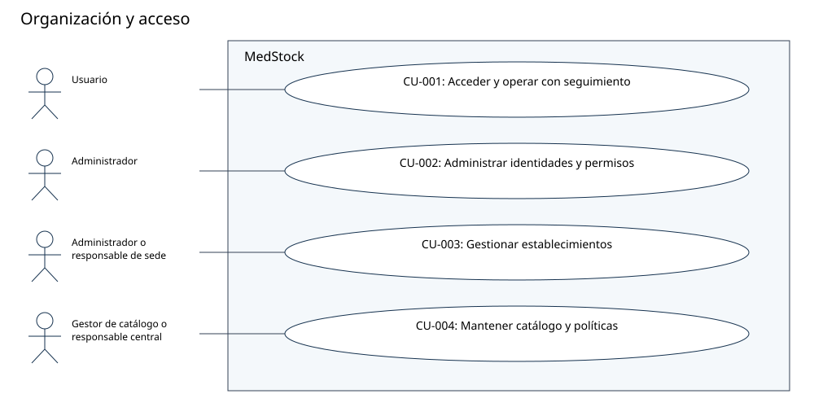
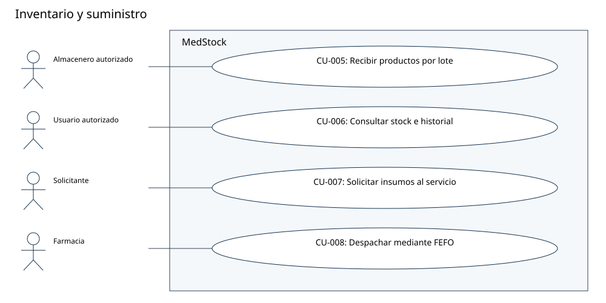
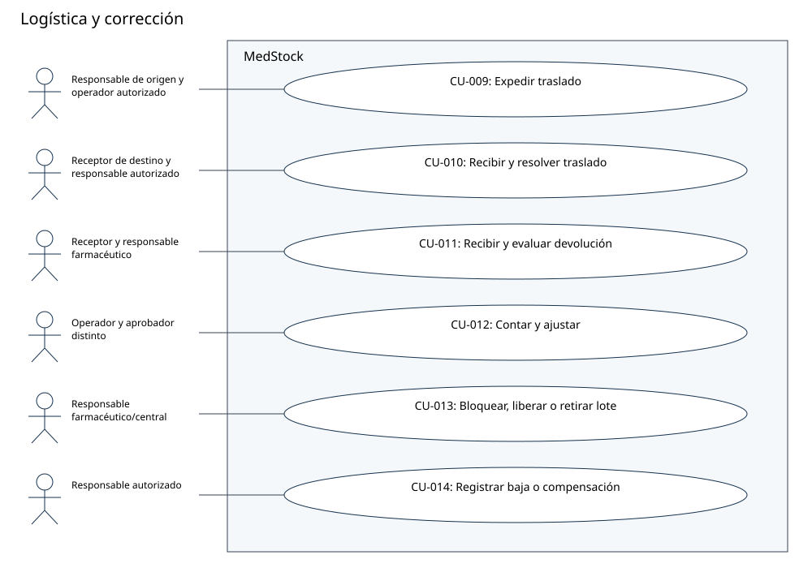
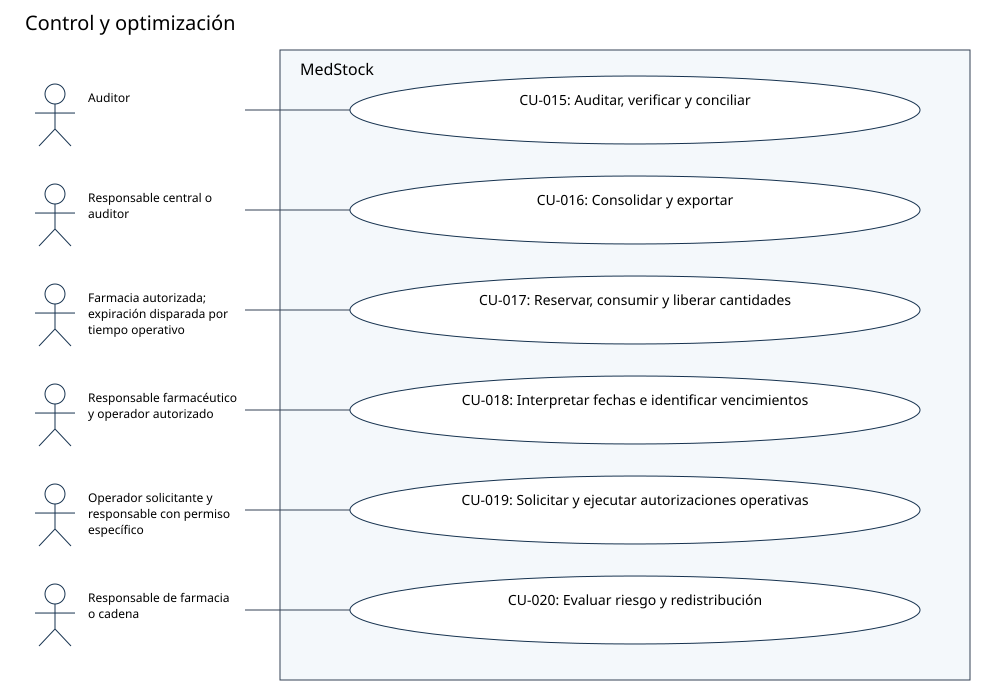

# Diagramas UML de casos de uso por módulo

Los óvalos representan objetivos del actor; las asociaciones no describen el orden temporal. Las actividades de cada CU están en [atlas de actividades](21-diagramas-de-casos-de-uso.md). Fuentes PlantUML editables y vistas SVG equivalentes.

## Organización y acceso

[Fuente PlantUML](../diagramas/puml/CU-modulo-1.puml). Los roles exactos están rotulados en la vista y en cada CU.

## Inventario y suministro

[Fuente PlantUML](../diagramas/puml/CU-modulo-2.puml). Los roles exactos están rotulados en la vista y en cada CU.

## Logística y corrección

[Fuente PlantUML](../diagramas/puml/CU-modulo-3.puml). Los roles exactos están rotulados en la vista y en cada CU.

## Control y optimización

[Fuente PlantUML](../diagramas/puml/CU-modulo-4.puml). Los roles exactos están rotulados en la vista y en cada CU.

