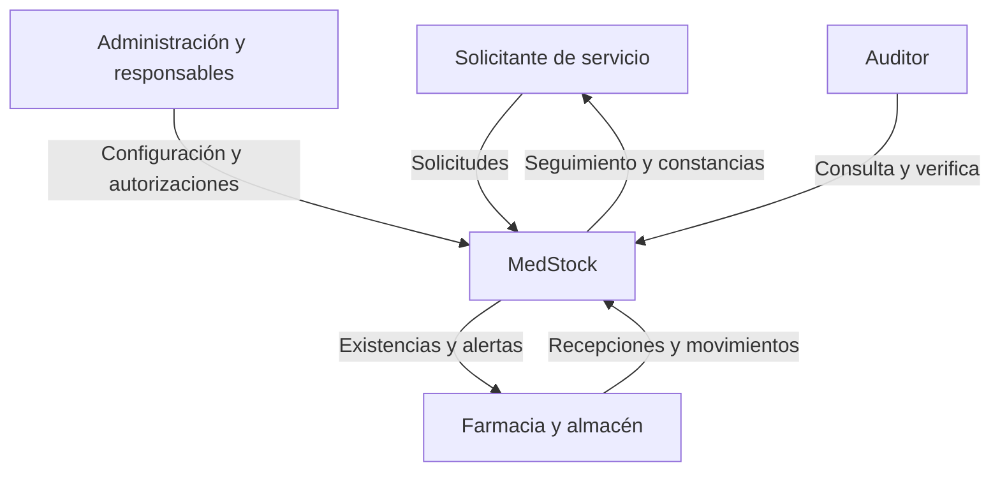

# Interesados, actores y permisos

**Proyecto:** MedStock · **Versión:** 0.1.0 · **Fecha:** 2026-10-15

**Estado:** borrador de análisis para revisión del propietario. Las políticas PP son propuestas.

## Interesados

| Interesado | Interés | Participación disponible |
|---|---|---|
| Alexander | Definir y desarrollar el producto | Propietario confirmado; revisión de decisiones |
| Docente IS-488 | Evidencia de requisitos, drivers y decisiones | Sílabo disponible; rúbrica específica pendiente |
| Dirección de cadena | Visibilidad y control transversal | Rol objetivo; representante real por identificar |
| Responsable farmacéutico | Elegibilidad y supervisión | Validación de políticas pendiente |
| Operadores y solicitantes | Flujo comprensible y rápido | Perfiles propuestos; no entrevistados |
| Auditoría | Reconstrucción y detección de cambios | Perfil objetivo |

## Actores y responsabilidades

Administrador gestiona identidad y organización; gestor de catálogo mantiene productos;
responsable de sede supervisa su ámbito; almacenero recibe y cuenta; solicitante
(médico o responsable de servicio autorizado) solicita; farmacia valida y despacha;
responsable farmacéutico libera o bloquea; receptor de destino confirma traslado;
auditor consulta y verifica. Una persona puede tener varios roles, pero una regla de
separación de funciones prevalece sobre la suma de permisos.

## Matriz propuesta de permisos

`S` = sedes asignadas; `C` = alcance de cadena asignado; `P` = propios; `—` = no
incluido por defecto. Cualquier permiso adicional exige asignación explícita.

| Operación | Administrador | Gestor catálogo | Responsable sede | Almacenero | Solicitante | Farmacia | Resp. farmacéutico | Auditor |
|---|---|---|---|---|---|---|---|---|
| Usuarios/roles | C | — | — | — | — | — | — | lectura C |
| Sedes/ubicaciones | C | — | S ubicaciones | — | — | — | — | lectura C |
| Productos/presentaciones | — | C | lectura S | lectura S | lectura S | lectura S | lectura C | lectura C |
| Recibir/conteo | — | — | supervisar S | S | — | S si asignado | supervisar S | lectura C |
| Solicitar | — | — | S | — | P/S | — | — | — |
| Despachar | — | — | — | — | — | S | S si asignado | — |
| Expedir/recibir traslado | — | — | autorizar S | S si asignado | — | S si asignado | supervisar S | lectura C |
| Proponer ajuste | — | — | S | S | — | S | S | — |
| Aprobar ajuste | — | — | S si asignado | — | — | — | S si asignado | — |
| Liberar cuarentena/bloquear | — | — | — | — | — | — | S/C asignado | lectura C |
| Auditoría/verificación | administrativa C | — | lectura S | — | P seguimiento | lectura S | lectura S/C | lectura C |
| Reportes/exportaciones | administrativa C | — | S | S si asignado | P | S | S/C | C |

La matriz es PP-011 y debe validarse con la organización; no concede al administrador
facultades clínicas automáticas. El permiso C no significa ver cualquier dato de
cualquier cadena: este proyecto gestiona una sola cadena, con sedes configurables.

## Restricciones transversales

Se comprueban permisos en cada operación, no solo ocultando botones. Un usuario
inactivo no opera. Un cambio de rol se audita y la revocación se aplica a la siguiente
operación protegida. En un traslado, origen autoriza/expide y destino confirma recepción;
los ajustes requieren otro aprobador (PP-009). El auditor carece de edición operativa.
No se pide aprobación obligatoria de otro desarrollador en GitHub, porque el equipo
es individual; la separación operativa se ensaya con usuarios distintos.

## Contexto del sistema

Este es contexto funcional de análisis; no fija contenedores ni proveedores.
