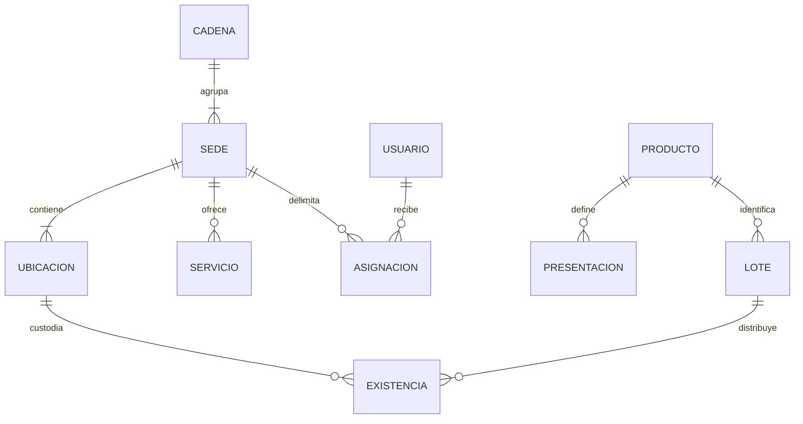
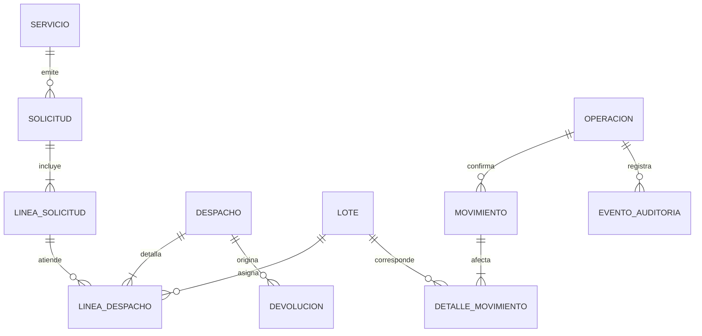
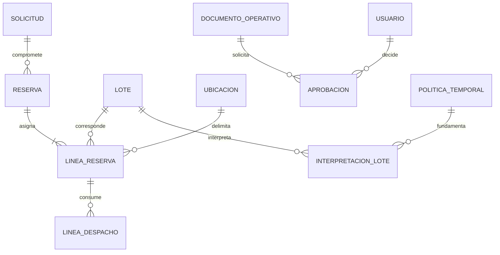

# Modelo conceptual del dominio

**Proyecto:** MedStock · **Versión:** 0.2.0 · **Fecha:** 2026-10-15

**Estado:** borrador de análisis para revisión del propietario. Las políticas PP son propuestas.

## Organización y saldos

Una existencia representa lote + ubicación + condición, no un único contador de
producto para toda la cadena. Un mismo lote aparece en varias existencias; no se
replica su identidad al trasladarlo. `ASIGNACION` relaciona usuario, rol y sede o
alcance central; no convierte el administrador en farmacéutico automáticamente.

## Documentos y movimientos

La solicitud usa producto y cantidad, mientras la línea de despacho concreta lotes.
Un movimiento logístico puede tener varios efectos de origen/destino/condición,
conservando la cantidad cuando es interno. `OPERACION` agrupa el resultado recuperable
con sus efectos; la tecnología para garantizar esa unidad aún no está elegida.

## Relaciones adicionales y cardinalidades

| Relación | Cardinalidad conceptual | Restricción |
|---|---|---|
| Producto–unidad base | Una por producto | Cambio con historia requiere migración controlada |
| Recepción–líneas | Una a una o más | Línea confirmada identifica lote y condición |
| Solicitud–despachos | Una a cero o más | La suma atendida no supera la solicitada |
| Traslado–recepciones | Uno a cero o más | Recepciones pueden ser parciales; límite expedido |
| Despacho–devoluciones | Uno a cero o más | Solo cantidades retornables por lote |
| Conteo–ajuste | Uno a cero o más revisiones propuestas | No aplicar dos aprobaciones del mismo delta |
| Lote–bloqueos | Uno a cero o más | Alcance y vigencia explícitos |
| Movimiento–corrección | Uno a cero o más | Referencia al original; comprobar efectos posteriores |
| Evento–referencia de cierre | Varios eventos a un cierre verificable | El cierre independiente permite detectar truncado |

## Límites conceptuales

Se identifican responsabilidades de organización/acceso, catálogo, inventario,
solicitudes/despachos, logística inversa y auditoría. No son microservicios
obligatorios. Un modelo conceptual no fija tablas, módulos físicos, proveedores ni
un diagrama de clases de implementación. Los detalles de recepción y traslado
referencian el mismo lote y operación para conservar trazabilidad.

## Reservas y decisiones de negocio

Una reserva solo compromete su remanente vigente. La aprobación refiere una versión
del contenido del documento operativo y no es un permiso global. La interpretación
del lote conserva su precisión y política, sin sustituir el rótulo original.
