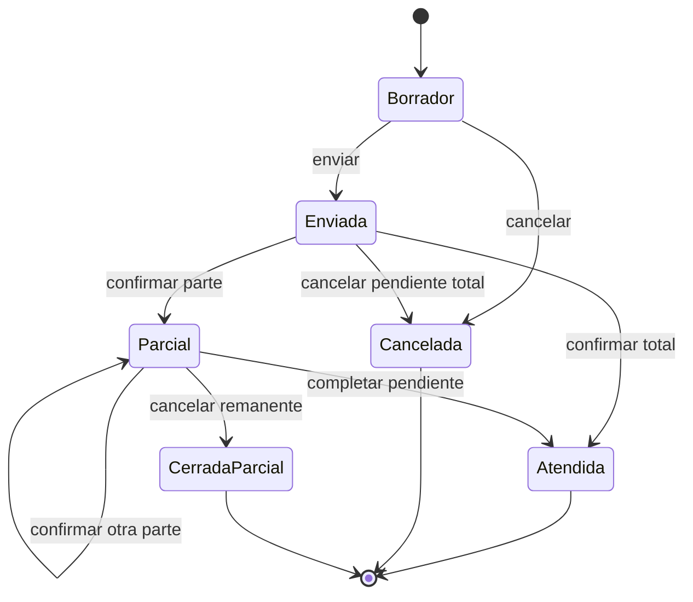
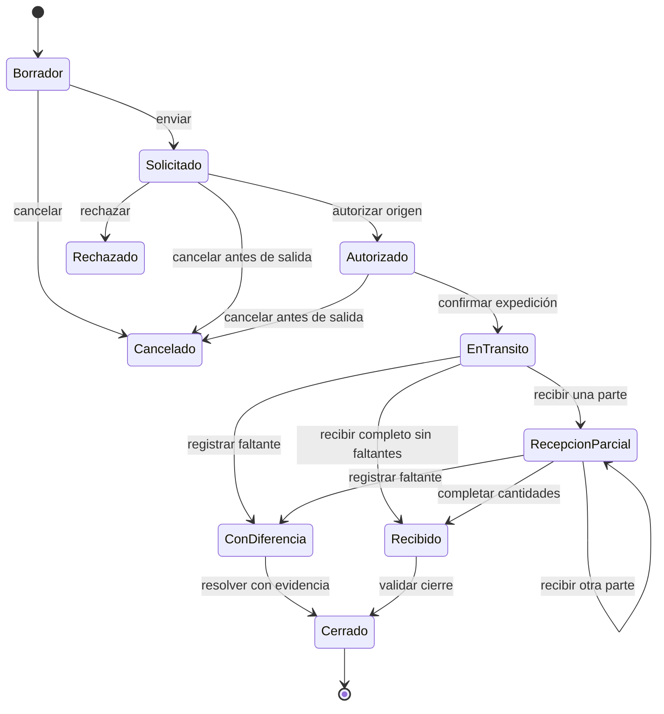
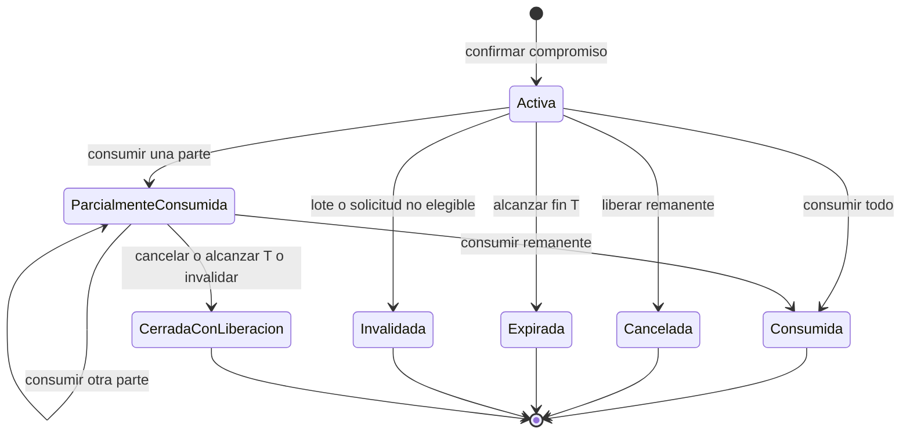

# Estados, eventos y transiciones

**Proyecto:** MedStock · **Versión:** 0.2.0 · **Fecha:** 2026-10-15

**Estado:** borrador de análisis para revisión del propietario. Las políticas PP son propuestas.

## Solicitud

La cantidad pendiente, entregada y cancelada verifica el estado. Una devolución no
reabre ni borra una solicitud atendida: registra el circuito de retorno. La política
para nueva demanda es crear otra solicitud, no incrementar de forma oculta la original.

## Traslado

Una vez expedido, no se cancela como borrador. Un retorno físico necesita un movimiento
inverso autorizado. Daños efectivamente recibidos se segregan en destino; faltantes
mantienen tránsito pendiente hasta resolver. Cerrar requiere cantidades conciliadas.

## Recepción, devolución y ajuste

| Documento | Transición | Autor / condición | Efecto |
|---|---|---|---|
| Recepción | Borrador → Confirmada | Receptor autorizado y datos válidos | Entrada por lote/condición |
| Recepción | Borrador → Cancelada | Antes de confirmar | Sin efecto |
| Recepción | Confirmada → Corrección vinculada | Autorización y efectos posteriores revisados | Nuevo movimiento, original permanece |
| Devolución | Registrada en cuarentena → Evaluada | Responsable farmacéutico | Cantidades liberadas o rechazadas, suma igual a recibida |
| Ajuste | Propuesto → Rechazado | Aprobador | Sin cambio de saldo |
| Ajuste | Propuesto → Confirmado | Otro aprobador y saldo revalidado | Compensación una sola vez |

Una evaluación parcial de devolución conserva el remanente en cuarentena hasta
completar; no se declara toda la devolución liberada al aprobar una línea.

## Condición y restricción de lote

Condición de existencia (utilizable/cuarentena/segregada) y restricción de lote
(bloqueado o no) son dimensiones distintas. El vencimiento se deriva de fecha y
contexto operativo; no se sobrescribe con el evento de liberación. Un lote puede
estar no bloqueado y aun así estar vencido. Bloquear no mueve cantidades físicas.

## Operación y comunicación

| Estado observado | Significado | Acción permitida |
|---|---|---|
| Rechazada conocida | No confirmó efectos | Corregir y crear una nueva intención |
| Confirmada | Existe resultado persistente coherente | Consultar o repetir la misma identidad/contenido |
| Incierta para el cliente | La respuesta no llegó; el resultado real aún se desconoce | Recuperar estado con identidad original |

La incertidumbre del cliente no es un estado de stock ni prueba de rollback. El
diseño determinará estados internos y recuperación sin introducir efectos duplicados.

## Reserva explícita

El estado temporal efectivo se evalúa al operar; la limpieza diferida no prolonga
vigencia. En cierres parciales se conserva la causa exacta (cancelación, expiración
o invalidación). Sumar consumido, liberado y remanente debe reconstruir la cantidad
inicial. Al cancelar la parte pendiente de una solicitud, sus reservas remanentes
se liberan de forma coherente; no se revierten unidades entregadas.

## Autorización sobre contenido

Pendiente → Aprobada o Rechazada; Aprobada → Invalidada si cambia el contenido
significativo o ya no es válida para ejecutar. Una nueva revisión se registra como
otra decisión vinculada y conserva la anterior. Ejecutar requiere además el permiso
vigente y las precondiciones de stock/lote. No se confunde este ciclo con la sesión
de acceso del usuario.
